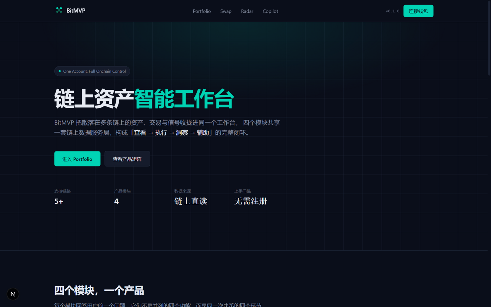
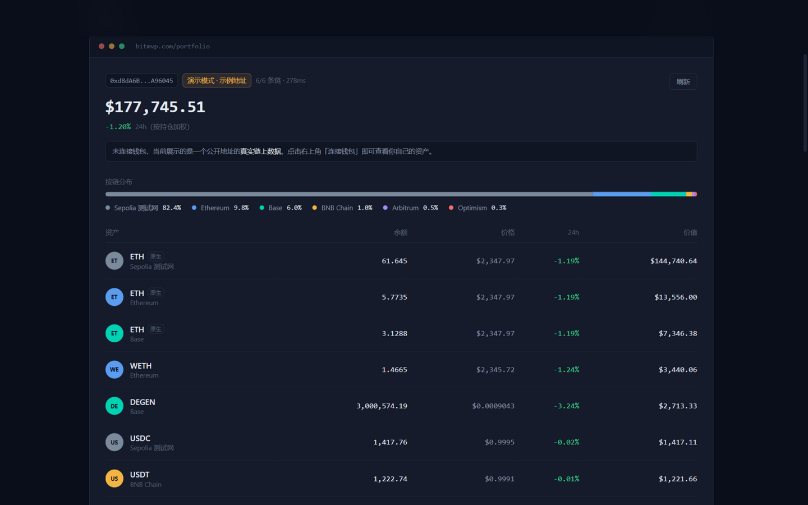
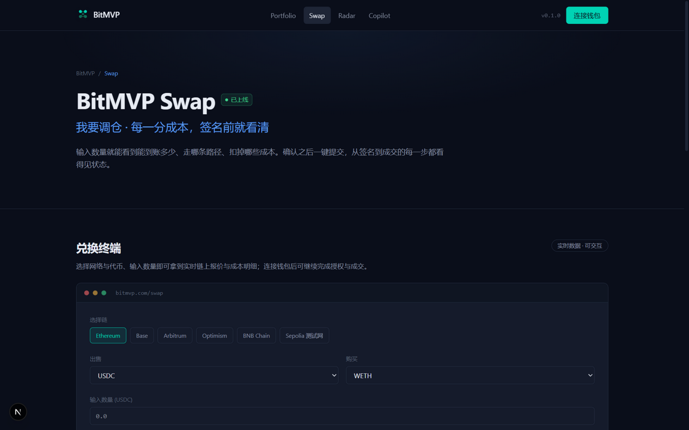
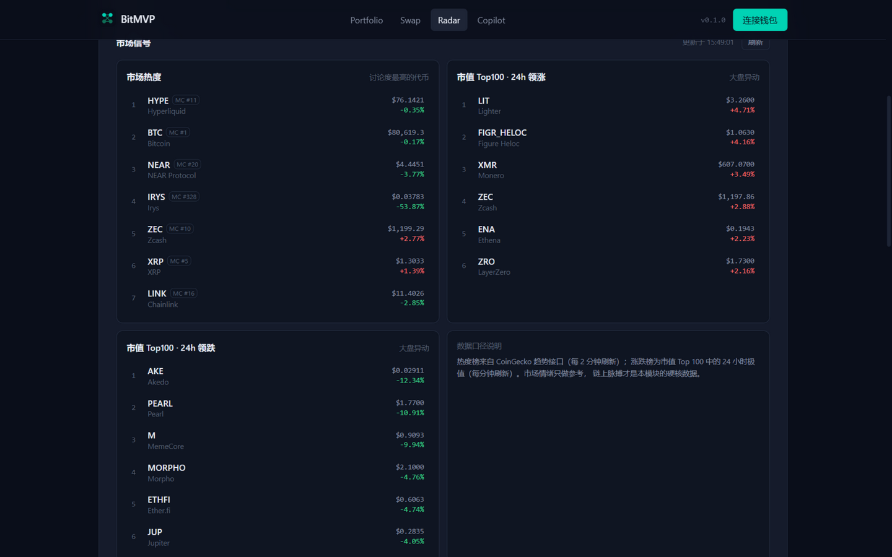
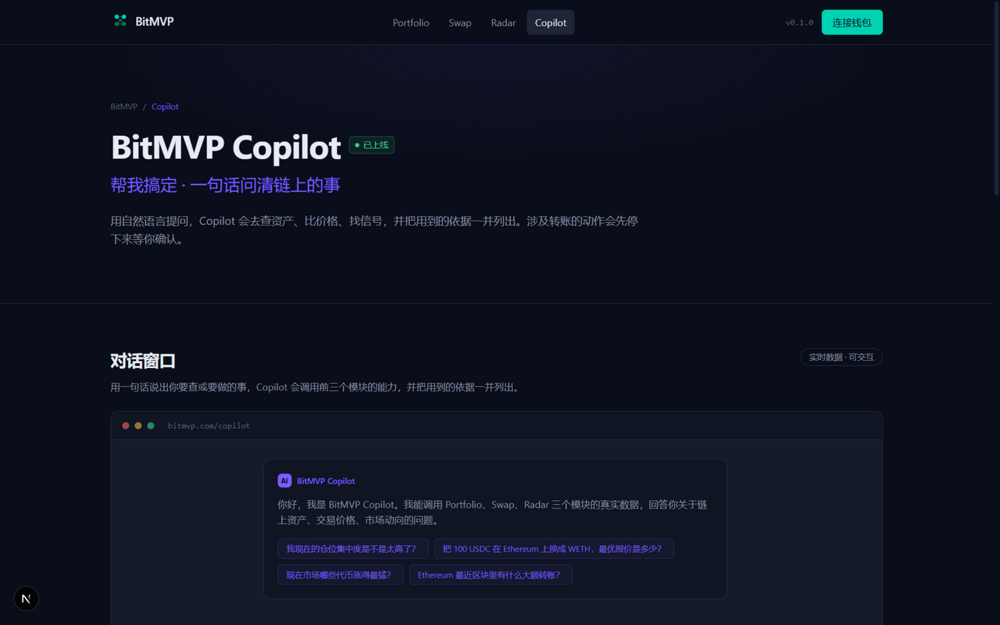
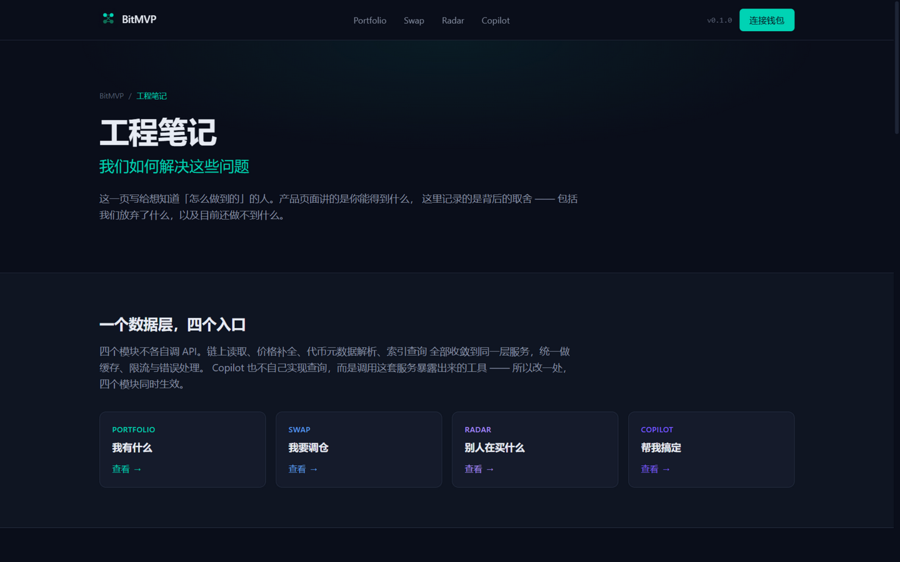

# BitMVP

一个 Web3 前端技术的学习项目。我想把 Web3 开发里常用的那批技术在真实环境里挨个过一遍，就做了这个站：Portfolio、Swap、Radar、Copilot 四个模块，全部跑在主网上——读的是真链，签的是真名，报的是真价。

一开始考虑过要不要加个后端。后来觉得加了后端，练的就成了后端，链上那部分全被包住，所以我干脆不写：数据直接从 RPC 和公开 API 读，签名在前端完成，AI 直接流式转发模型响应。代价是限流、超时这些问题全都直接砸到我脸上，但好处是也因此看清了它们的真实边界。

- 线上地址：<https://bitmvp.com>

## 截图

| | |
| ---- | ---- |
|  |  |
|  |  |
|  |  |

## 四个模块，四个问题

### Portfolio：怎么把多链余额读快

用户在五条链上都有代币，一条条查太慢：30 个代币就是 30 次 RPC 请求。查了一下发现业界普遍用 Multicall3 这个合约，能把一批 `balanceOf` 打包成一次调用。接入后实测，五条链各发一次请求就够了，150 次调用变 5 次。

价格接的 CoinGecko 免费档，限流很紧，所以写了个简单的 LRU 缓存，给不同数据设不同过期时间：余额 15 秒，因为用户操作后要马上看到变化；价格 60 秒，没必要更快，还会浪费配额；ENS 300 秒，名字基本不变。这套数值是按使用场景估的，后期可能还要调。

ENS 解析用 viem 直连 mainnet 就行，本来以为要额外服务，实际上 viem 内置了。

### Swap：不靠聚合 API 能不能成交

0x 和 1inch 在 2026 年都开始按请求收费了，想不花钱就只能直接读链。Uniswap V3 的 QuoterV2 合约就是干这个的：传入代币对、数量和费率，返回能换多少。我对 500/3000/10000 三档费率各查一遍，取最优。

严格说这不是聚合器，只有 Uniswap V3 一个来源，价格未必是全网最好，但对学习目的正合适——顺带搞清楚了报价的本质：它就是个合约读操作，不是什么 web API 魔法。

成交要两步：先 approve 授权，再 swap。都用 wagmi 签名，每步状态回显给用户。这里踩了 wagmi v3 的两个坑：hook 叫 `useAccount` 不是 `useConnection`；`injected` 要从 `wagmi/connectors` 导入，不是 `@wagmi/connectors`。网上资料混着旧版本写法，照抄会报错。

### Radar：不经过第三方，能从链上挖出什么

这个模块给自己定的规则是只用原始数据：直连公共 RPC 扫最新区块，解析出大额转账、交易数、Gas 拥挤度。鲸鱼转账是真的从区块里捞出来的记录，不是某家数据商加工后的结果。

上游稳定性也主要在这个模块里测。一条链的 RPC 抽风，就只降级那一条，别的链照常；行情 API 不可用就在界面上写明原因，不给假数据。这些处理看着琐碎，真遇到上游挂掉的时候全靠它们兜底。

### Copilot：让 AI 去查链上数据

LLM 本身访问不了链，所以要给它工具。我把前三个模块的查询函数包成 function calling 的工具集（`lib/copilot/tools.ts`），模型自己决定调哪个，拿到真实结果再回答。问「100 USDC 换 WETH 最低报价多少」，它会真的去链上询价，而不是编一个数。

模型用的智谱 GLM-5.3-Flash，走 OpenAI 兼容协议。理论上换模型就是换个 base URL 和 Key，这点我只换了 DeepSeek 验证过一半，没完整测。

流式输出踩了一个 Vercel 的坑：Node 函数默认 10 秒超时，长回答直接被掐断。换成 Edge runtime 就好了，默认 30 秒。

### 工程笔记

站内 `/engineering` 页面，把上面这些结论整理成对外的说明。学习项目如果只留代码不留结论，过两个月自己都看不懂当时为什么这么写，所以专门开了这一页，连「目前做不到什么」也一起写上。

## 关于「只写一份数据层」

四个模块都从 `lib/chain/*` 读数据。这是我给自己定的规矩，想验证的问题是：多个模块共用一个数据抽象，最后会不会被迫开洞、写出第二套实现？

到目前的规模还没到那一步。改 RPC 只动 `chains.ts` 一个文件；加新模块就是 `lib/chain/foo.ts` 配一个页面。AI 的工具集也是从这份数据层生成的，所以它查不到产品里没有的东西，顺带解决了「模型乱承诺」的问题。

当然，现在项目还小，这个结论能不能撑到更大规模不好说，先记录到这里。

## 目录结构

```
├── app/          # Next.js 15 (App Router) + TS + Tailwind v4 + wagmi 3 + viem
│   ├── portfolio|swap|radar|copilot/  # 四个模块页面
│   ├── engineering/   # 工程笔记页
│   └── api/           # portfolio/[address] · swap/quote · radar/market · radar/onchain · copilot/chat (Edge SSE)
├── components/   # 页面组件 + wallet/swap/radar/copilot 各模块组件
├── lib/
│   ├── chain/    # 链上数据层（全站唯一数据来源）
│   │             #   chains/tokens 多链配置 · portfolio 余额聚合 · swap 报价
│   │             #   radar 区块扫描 · prices 价格 · cache LRU+TTL 缓存
│   ├── copilot/tools.ts  # AI 工具定义 + 执行器（复用 chain/*）
│   └── products.ts       # 模块文案与元数据（单一数据源）
└── docs/         # 产品架构、数据层选型、品牌视觉规范等设计文档
```

## 快速开始

```bash
npm install
npm run dev        # 打开 http://localhost:3000

npm run build      # 构建
npm run start      # 生产服务
```

环境变量放在 `.env.local`（不入库）。只有 Copilot 要配 `GLM_API_KEY=xxx`（智谱开放平台申请），不配也能跑。只想先玩链上读写部分的话，零配置直接启动就行。

## 提交与构建注意

- 提交前跑 `npm run lint`，CI/托管构建会把 ESLint Error 挡下来

## 部署

托管平台（Vercel）部署，Root Directory 设为仓库根目录；`GLM_API_KEY` 在平台后台维护（生产 + preview 都要配）；自定义域名 bitmvp.com。架构决策、数据层选型与设计规范见 `docs/`。
